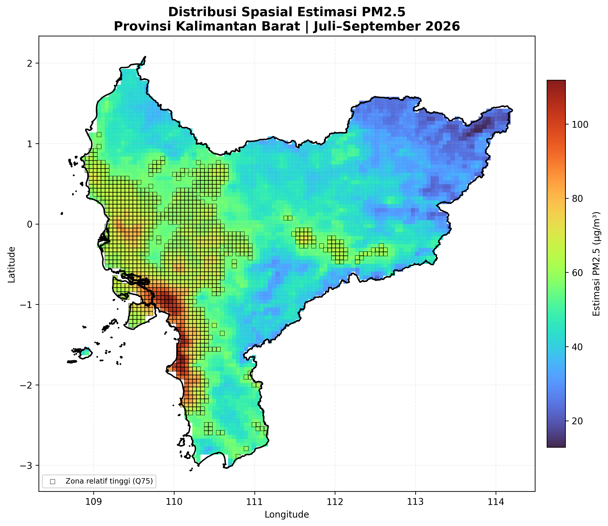
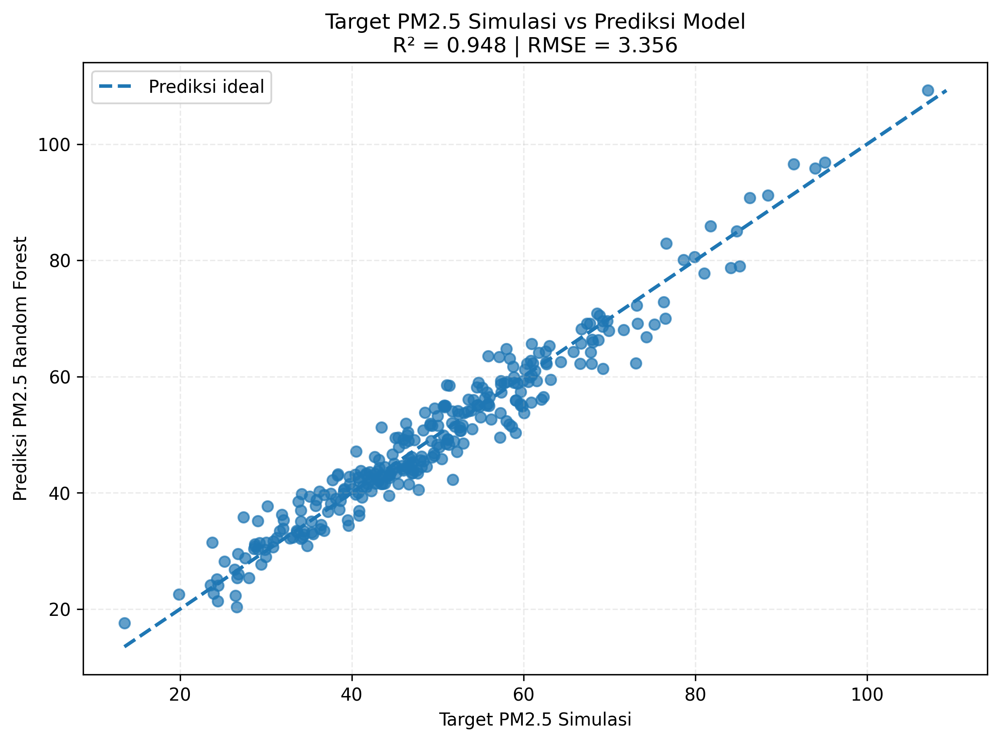
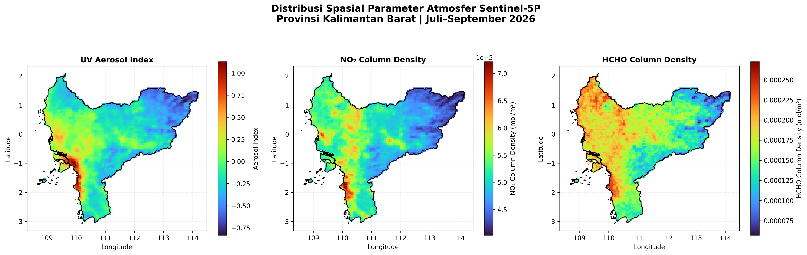
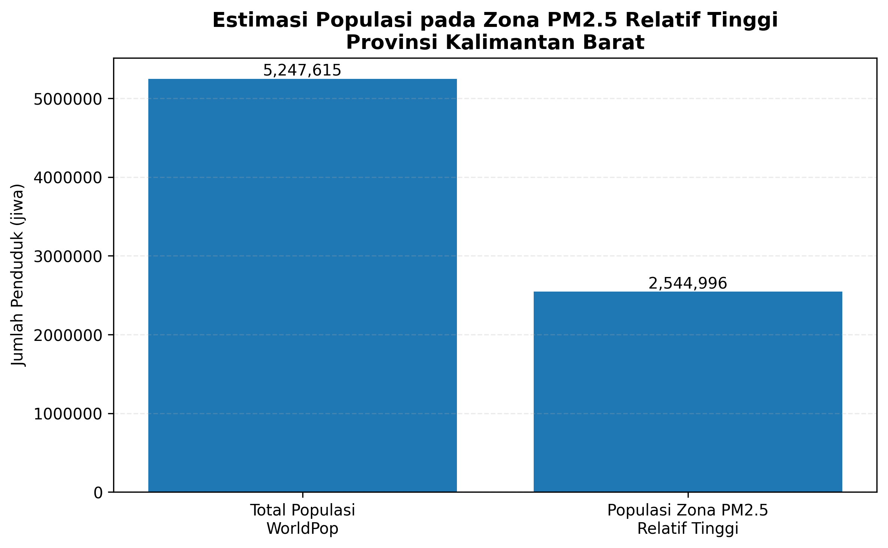

# West Kalimantan PM2.5 Estimation and Wildfire Air Quality Analysis


Remote sensing-based spatial estimation of PM2.5 and population exposure assessment over West Kalimantan, Indonesia.

## Live Dashboard

**Interactive Dashboard:**  
https://west-kalimantan-pm25.streamlit.app/

This project presents a spatial analysis of estimated PM2.5 concentrations
in West Kalimantan, Indonesia, with supporting analysis of wildfire-related
air quality conditions.

The project combines geospatial analysis, remote sensing, machine learning,
and population exposure assessment to examine the spatial distribution of
estimated PM2.5.

---

## Project Overview

This project was developed as an independent learning project based on a
Google Earth Engine geospatial analysis workflow.

The analysis focuses on West Kalimantan and examines the spatial distribution
of estimated PM2.5 concentrations during July-September 2026.

The project also provides supporting information on population exposure,
model performance, and atmospheric indicators.

---

## Objectives

The main objectives of this project are:

- Estimate the spatial distribution of PM2.5 concentrations.
- Identify areas with relatively high estimated PM2.5.
- Evaluate the performance of the Random Forest model.
- Estimate population exposure to relatively high PM2.5 concentrations.
- Present the analysis through an interactive web dashboard.
- Support further interpretation of wildfire-related air quality conditions.

---

## Study Area

**Study area:** West Kalimantan Province, Indonesia

**Analysis period:** July-September 2026

The study area was selected to examine spatial variation in estimated PM2.5
and its potential relationship with wildfire and biomass-burning conditions.

---

## Data and Analysis

The project uses geospatial analysis outputs generated through a
Google Earth Engine workflow and processed into analysis-ready datasets.

The project includes:

- Spatial PM2.5 estimation data
- PM2.5 summary statistics
- Random Forest model performance data
- Population exposure estimation
- Atmospheric indicator information
- Spatial visualization outputs

The processed datasets are provided in the `data/` directory.

---

## Machine Learning Model

A Random Forest model was used for PM2.5 estimation.

The dashboard reports the following model performance indicators:

- **RMSE:** 3.356
- **R²:** 0.948
- **Q75 threshold:** 56.763

The Q75 threshold is used in the dashboard to identify relatively high
PM2.5 conditions.

---

## Population Exposure

The dashboard provides an estimation of population exposure based on the
spatial PM2.5 results and WorldPop population data.

The current analysis reports:

- **Total population:** 5,247,615
- **Population in relatively high PM2.5 zones:** 2,544,996
- **Estimated exposure percentage:** 48.50%

These values represent model-based spatial estimates and should be
interpreted within the limitations of the underlying datasets and analysis
period.

---

## Interactive Dashboard

The interactive PM2.5 dashboard is available for local
execution using Streamlit.

Access the live dashboard:

[West Kalimantan PM2.5 Dashboard](https://west-kalimantan-pm25.streamlit.app)

### Run locally

Install the required Python packages:

```bash
pip install -r requirements.txt
---

The dashboard application is implemented in:

```text
app.py
---

## Google Earth Engine

Google Earth Engine is used for geospatial data preparation and satellite-based atmospheric data processing.

The Earth Engine workflow is stored in:

```text
gee/Kalbar_PM25_RasterInput.js
```

## Repository Structure

```text
wildfire-air-quality-west-kalimantan/
│
├── data/
│   ├── model_performance_kalbar.csv
│   ├── pm25_spatial_kalbar.csv
│   └── pm25_summary_kalbar.csv
│
├── figures/
│   ├── model_performance_kalbar.png
│   ├── paparan_populasi_kalbar.png
│   ├── parameter_atmosfer_s5p_kalbar.png
│   └── peta_pm25_kalbar.png
│
├── gee/
│   └── Kalbar_PM25_RasterInput.js
│
├── notebooks/
│   └── Estimasi_PM25_Karhutla_Kalimantan_Barat.ipynb
│
├── outputs/
│
├── scripts/
│
├── app.py
├── README.md
└── requirements.txt

---

## Installation

Clone the repository:

```bash
git clone https://github.com/dedylesmana/wildfire-air-quality-west-kalimantan.git
cd wildfire-air-quality-west-kalimantan
```

Install the required Python packages:

```bash
pip install -r requirements.txt
```

---

## Usage

Run the interactive dashboard:

```bash
streamlit run app.py
```

The application can then be accessed through the local Streamlit server.

---

## Results Summary

The Random Forest model achieved an R2 of 0.948 and an RMSE of 3.356 based on the available model evaluation dataset.

The trained model was applied to spatial predictor data to generate estimated PM2.5 concentrations across West Kalimantan during July-September 2026.

Relatively high PM2.5 areas were identified using the 75th percentile threshold of the estimated PM2.5 distribution.

The resulting spatial estimates were integrated with WorldPop 2020 population data to assess the population potentially exposed to relatively high estimated PM2.5 concentrations.

The analysis outputs include spatial PM2.5 estimation, model performance evaluation, Sentinel-5P atmospheric parameter analysis, population exposure assessment, and an interactive visualization dashboard.

---

## Research Outputs

The main outputs of this project include:

- Spatial PM2.5 estimation over West Kalimantan
- Random Forest model performance evaluation
- Sentinel-5P atmospheric parameter analysis
- Identification of relatively high PM2.5 areas
- Population exposure assessment
- Interactive PM2.5 visualization dashboard

### Spatial Distribution of Estimated PM2.5



**Figure 1.** Spatial distribution of estimated PM2.5 over West Kalimantan during July-September 2026.

The map shows the spatial distribution of estimated PM2.5 generated using the trained Random Forest model and spatial predictor data.

### Random Forest Model Performance



**Figure 2.** Performance evaluation of the Random Forest PM2.5 estimation model.

The model performance is evaluated using the coefficient of determination (R2) and root mean square error (RMSE).

### Sentinel-5P Atmospheric Parameters



**Figure 3.** Spatial distribution of selected Sentinel-5P atmospheric parameters used in the analysis.

The atmospheric indicators provide spatial information used as predictors in the PM2.5 estimation workflow.

### Population Exposure Assessment



**Figure 4.** Population exposure assessment within relatively high estimated PM2.5 areas.

WorldPop 2020 population data are integrated with the estimated PM2.5 distribution to identify potentially exposed populations.

---

## Google Earth Engine

Google Earth Engine is used for geospatial data preparation and satellite-based atmospheric data processing.

The Earth Engine workflow is stored in:

```text
gee/Kalbar_PM25_RasterInput.js
```

This script supports the preparation of spatial predictor data used in the PM2.5 estimation workflow.

---

## Interactive Dashboard

This project includes an interactive Streamlit dashboard for exploring the spatial PM2.5 estimation results over West Kalimantan.

The dashboard provides interactive visualization of:

- Estimated PM2.5 concentrations
- Spatial distribution of PM2.5
- Relatively high PM2.5 areas
- Population exposure
- Random Forest model performance
- Supporting atmospheric indicators

The main application is:

```text
app.py
```

### Live Dashboard

The interactive PM2.5 dashboard is available for local execution using Streamlit.

To run the dashboard locally:

```bash
streamlit run app.py
```

---

## Research Context

This project is part of a broader research workflow on wildfire, atmospheric pollution, remote sensing, geospatial analysis, and machine learning.

The workflow is designed to support spatial assessment of PM2.5 conditions associated with wildfire and biomass-burning activity in West Kalimantan.

The results can support further research on air quality monitoring, wildfire impact assessment, spatial exposure analysis, and environmental decision support.

---

## Author

**M. Dedy Lesmana**

Independent learner working on remote sensing, geospatial analysis,
machine learning, and wildfire air quality assessment.

Indonesia

---

## License

This project is provided for research and academic purposes.

Please contact the author before using the project for commercial purposes or redistributing modified versions.